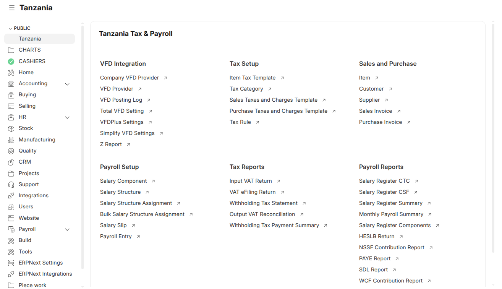

# CSF TZ

**Country Specific Functionality Tanzania** extends ERPNext for businesses operating in Tanzania. It adds statutory and tax compliance, VFD fiscalisation, regulatory integrations, payroll extensions, bank payment integrations, and localised accounting and stock tools, while keeping standard ERPNext behaviour and upgradeability intact.

This README describes the `version-16` line (Frappe / ERPNext v16).



## Requirements

- Frappe Framework v16 and ERPNext v16 (the app navigation described below needs Frappe 16.50+)
- HRMS, for the payroll, attendance, leave and employee advance features
- Python 3.10+

## Installation

```bash
bench get-app https://github.com/Aakvatech-Limited/csf_tz.git --branch version-16
bench --site <your-site> install-app csf_tz
bench --site <your-site> migrate
bench restart
```

Installing the app creates its custom fields and property setters on standard ERPNext and HRMS DocTypes. They are re-applied on every `migrate`.

## Modules

| Module | What it covers |
|---|---|
| CSF TZ | Tax, statutory returns, TRA/VFD, regulatory integrations, finance, payroll extensions, Tanzanian geographic masters |
| VFD Providers | Connectors for VFD providers (TotalVFD, VFDPlus, Simplify, DIRM) |
| VFD Settings | Per-company VFD provider assignment |
| Stanbic | Stanbic bank payment initiation and SFTP status sync |
| KCB | KCB bank payment initiation with PGP-encrypted files |
| Purchase And Stock Management | Bin setup, order and shipment tracking, purchasing reports |
| Sales And Marketing | Customer interests, past sales, payment plans, sales reports |
| Meal Count | Biometric devices, users, meal types and meal logs |

## Features

### Tax and fiscal compliance

- **VFD integration**: posts Sales Invoices to the configured VFD provider, either automatically on submit or through a scheduled retry. It validates VFD rules before submit and cancel, and cleans customer TIN/VRN details.
- **Electronic Fiscal Devices**: EFD and EFD Z Report records for reconciliation.
- **TRA invoice verification**: verifies invoices against the TRA verification portal through TRA Tax Inv.
- **Withholding tax**: automatic GL entries on submit of Sales and Purchase Invoices.
- **Statutory reports**:
  - VAT e-filing returns, TRA input VAT returns and output VAT reconciliation
  - Exempt purchases
  - Excise duty reports
  - Withholding tax reports
  - SDL (ITX 215.03.E) and withholding tax statements (ITX 219/230)

### Regulatory and fleet compliance

- **Traffic fines**: Vehicle Fine Record checks Tanzania Police Force TMS for offences.
- **LATRA**: LATRA licence and offence tracking, synced from the LATRA RRIMS portal.
- **TIRA**: insurance cover notes verified against TIRAMIS.
- **Vehicle sync**: queued background syncing of vehicles. Authority notifications for LATRA, TIRA and vehicle fines can be configured per role, on new records or on status changes.

### Accounting and finance

- **Foreign Import Transaction**: tracks exchange differences across Purchase Invoices, Payment Entries and Landed Cost Vouchers for imports.
- **Bank charges**: patterns and automatic bank-charge journals from Payment Entries.
- **Budget checks**: optional checks on Purchase Orders, Purchase Invoices, Material Requests and Journal Entries.
- **Write-off journals**: optional write-off Journal Entries for Sales Invoices, Purchase Invoices and Payment Entries.
- **Reports**:
  - Multi-currency receivables and ledgers
  - General Ledger Pro, Gross Profit Pro and trial balance in USD
  - Bank reports and reconciliation aids
  - Monthly sales and purchase summaries

### Payroll and HR (requires HRMS)

- **Salary Slip, Additional Salary and Leave Encashment overrides**, including fixed working days per month and custom salary slip email messages.
- **Payroll approval** and payroll entry controls.
- **Overtime**: calculation from Attendance.
- **Additional salary**: scheduled generation and journal posting.
- **Employee Advance**: payment and expense automation.
- **Statutory reports**:
  - PAYE
  - NSSF
  - WCF
  - HESLB
  - SDL
  - Several salary register variants
  - Payroll for mobile payment

### Banking integrations

- **Stanbic**: payment initiation from Payment Entries and Payroll Entries. Bank status files are synced over SFTP.
- **KCB**: payment initiation from supplier Payment Entries and Payroll Entries, with PGP-encrypted payment files and batch summary PDFs.

### Sales, stock and purchasing

- **Delivery notes**: optional automatic Delivery Note creation from Sales Invoices, plus scheduled auto-close of Delivery Notes.
- **Sales Invoice controls**: batch splitting, net-rate and grand-total validation, and price reduction.
- **Stock tools**:
  - Auto-close of Material Requests
  - Stock reconciliation from Material Requests
  - Stock Entry import from BOM
  - Item revaluation for incorrect balance quantities
- **Reports**: stock balance and ledger reports, warehouse-wise balances and reorder reports.

### Localisation and utilities

- **Tanzanian geographic data**: regions, districts, wards, villages and postcodes. They can be populated from CSF TZ Settings.
- **QR codes**: a QR code generator available in print formats. Employee contact QR codes.
- **Meal Count**: a QR scanner page that records biometric meal logs.
- **Job Cards page**: for the Manufacturing domain.
- **CSF API Response Log**: for troubleshooting integrations.

## Configuration

Most behaviour is controlled from **CSF TZ Settings**, which is organised into four tabs:

- **Sales & Purchase**: Sales Invoice, tax and Purchase Order / Material Request options
- **Stock & Accounting**: stock options, write-offs and budget checks
- **HR & Payroll**: payroll overrides, payroll approval and overtime
- **System & Data**: Tanzanian regions data, vehicle sync and authority notifications

Integrations each have their own settings DocTypes: VFD provider settings, Company VFD Provider, Stanbic Setting, KCB Settings, LATRA Settings and Foreign Import Settings.

## App navigation (Frappe 16.50+)

Open **CSF TZ** from the Apps screen to reach the **Tanzania** workspace (`/desk/tanzania`). The app dock links to every module's landing workspace. Finance, payroll and administration have their own workspaces in the CSF TZ sidebar.

Navigation does not grant any permissions. Users see only what their roles allow, and several setup and banking workspaces are restricted to System Manager.

See [docs/app-navigation.md](docs/app-navigation.md) for the full coverage matrix and validation checklist.

## Contributing

1. Fork the repository and create a branch from the relevant version branch.
2. Install the pre-commit hooks: `pre-commit install`.
3. Use [Conventional Commits](https://www.conventionalcommits.org/), for example `fix: correct VFD retry on cancel`.
4. Open a pull request against the version branch.

[SPEC.md](SPEC.md) describes the architecture principles for CSF TZ: where code belongs, how to use hooks and overrides, and how integrations are kept isolated.

## Support

Please raise a [GitHub issue](https://github.com/Aakvatech-Limited/csf_tz/issues).

## Licence

GNU General Public License v3. See [license.txt](license.txt).
